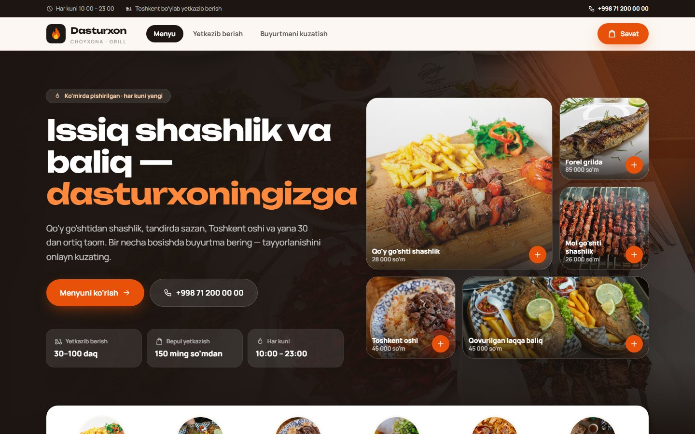
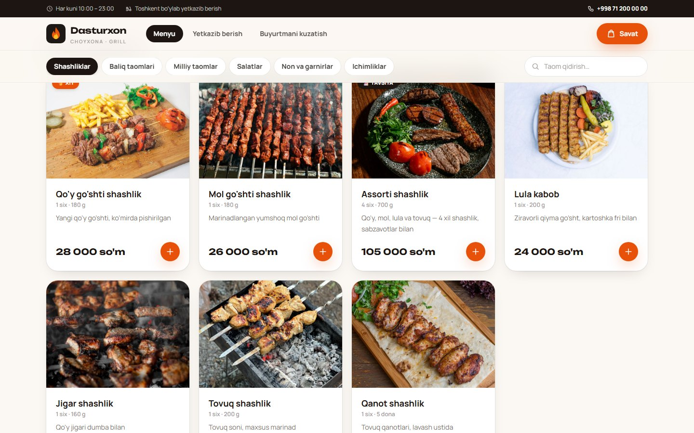
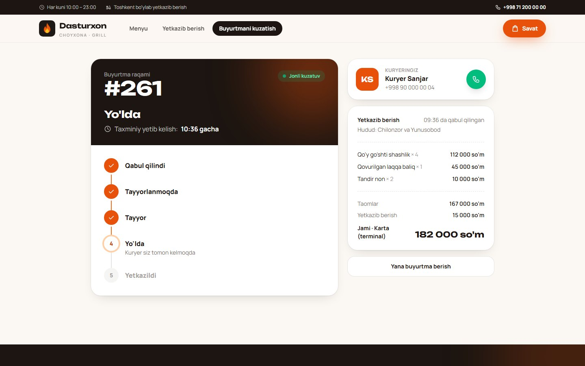
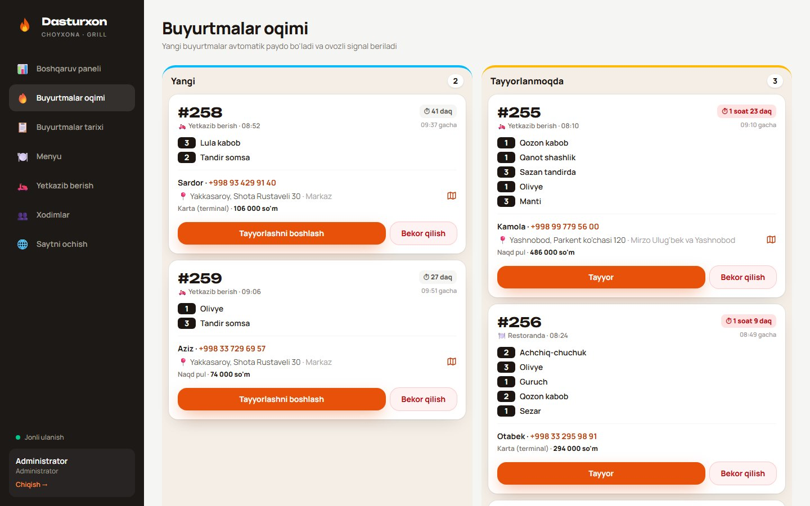
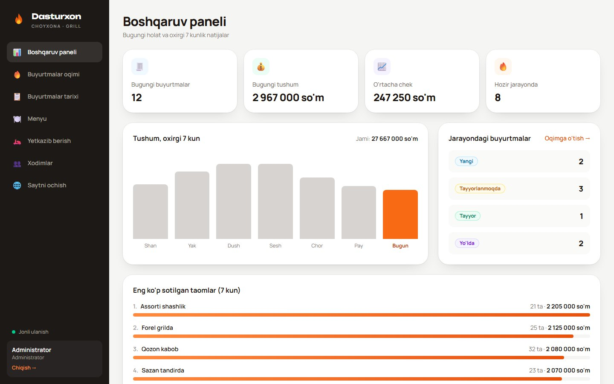
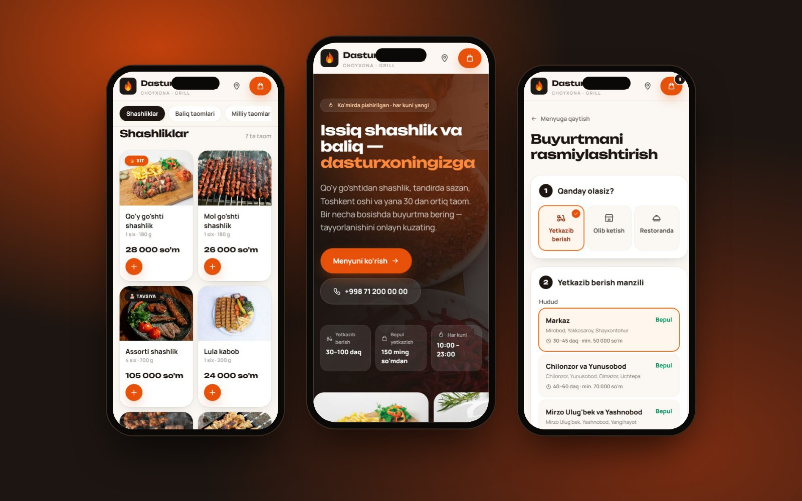

# Dasturxon — restoran boshqaruv tizimi

Baliq, shashlik va milliy taomlar restorani uchun onlayn buyurtma, yetkazib berish va boshqaruv tizimi.
Mijozlar saytdan buyurtma beradi va uni jonli kuzatadi, oshxona va kuryerlar buyurtmalarni real vaqtda ko'radi,
rahbar savdo statistikasini kuzatadi.

**Stack:** ASP.NET Core 10 · EF Core (SQLite / SQL Server) · SignalR · JWT · React 19 · TypeScript · Tailwind CSS · Vite · xUnit



| Menyu | Buyurtmani kuzatish |
|---|---|
|  |  |
| **Oshxona ekrani** | **Dashboard** |
|  |  |



## Ishga tushirish

| Yo'l | Nima qilinadi |
|---|---|
| **Eng oson** | `Ishga-tushirish.bat` ni ikki marta bosing — brauzer o'zi ochiladi. |
| **Visual Studio** | `RestaurantSystem.sln` → **F5** (profil: *Sayt + API*). |
| **VS Code** | `C:\projects` papkasini oching → **F5** (*Sayt + API*) yoki `Ctrl+Shift+B`. |

| Manzil | Nima |
|---|---|
| http://localhost:5173 | Mijozlar sayti: menyu, savat, buyurtma, kuzatish, yetkazib berish shartlari |
| http://localhost:5173/admin | Xodimlar paneli |
| http://localhost:5011/swagger | API hujjatlari (faqat Development rejimida) |

Kerakli dasturlar: .NET 10 SDK, Node.js LTS.

## Demo xodimlar

Birinchi ishga tushishda yaratiladi (`src/Restaurant.WebApi/appsettings.Development.json`):

| Rol | Telefon | Parol | Nimani ko'radi |
|---|---|---|---|
| Administrator | 90 000 00 01 | `Admin#2026` | Hammasi, xodimlarni boshqarish |
| Menejer | 90 000 00 02 | `Menejer#2026` | Dashboard, buyurtmalar, menyu, yetkazib berish hududlari |
| Oshpaz | 90 000 00 03 | `Oshpaz#2026` | Oshxona oqimi, stop-list |
| Kuryer | 90 000 00 04 | `Kuryer#2026` | Yetkaziladigan buyurtmalar |
| Kuryer | 90 000 00 05 | `Kuryer#2026` | Yetkaziladigan buyurtmalar |

> Bu faqat demo parollar. Ular serverga chiqmaydi (publish'dan chiqarib tashlangan).

## Imkoniyatlar

- **Mijoz sayti:** foto-menyu (32 ta taom), qidiruv, savat, 3 xil olish usuli, buyurtmani jonli kuzatish.
- **Yetkazib berish:** hududlar bo'yicha narx, eng kam buyurtma, bepul yetkazish chegarasi, taxminiy vaqt,
  to'lov usuli (naqd / karta), kuryer biriktirish — mijoz kuryerning ismi va telefonini ko'radi.
- **Buyurtmalar oqimi:** yangi buyurtma ovozli signal bilan chiqadi. Holatlar: Yangi → Tayyorlanmoqda → Tayyor →
  Yo'lda → Yakunlandi. Har bir rol faqat o'ziga ruxsat berilgan tugmani ko'radi.
- **Dashboard:** bugungi buyurtmalar, tushum, o'rtacha chek, 7 kunlik grafik, eng ko'p sotilgan taomlar.
- **Boshqaruv:** menyu (rasm, narx, porsiya, «Xit/Yangi» belgisi, stop-list), hududlar, xodimlar.

## Tuzilishi

```
C:\projects
├── RestaurantSystem.sln            ← Visual Studio shu faylni ochadi
├── Ishga-tushirish.bat             ← bir bosishda ishga tushirish
├── Publish.bat                     ← serverga yuklanadigan "publish" papkasini tayyorlaydi
├── deploy\                         ← server sozlamalari namunalari
├── src
│   ├── Restaurant.Data             ← EF Core: jadvallar, DbContext, SQLite migratsiyalari
│   ├── Restaurant.Data.SqlServer   ← SQL Server migratsiyalari
│   ├── Restaurant.Business         ← biznes-logika: servislar, holatlar zanjiri, yetkazib berish, seed
│   ├── Restaurant.WebApi           ← ASP.NET Core API, JWT, SignalR (real vaqt)
│   └── Restaurant.Web              ← React + TypeScript + Vite + Tailwind (frontend), rasmlar: public/images
└── tests\Restaurant.Tests          ← xUnit testlar
```

## Ma'lumotlar bazasi: SQLite yoki SQL Server

`Database:Provider` sozlamasi bilan tanlanadi:

- **SQLite** (standart, demo uchun) — baza bitta fayl: `src/Restaurant.WebApi/App_Data/restaurant.db`.
  DB Browser for SQLite bilan ochib ko'rish mumkin. Bazani noldan boshlash uchun ilovani to'xtatib `App_Data` ni o'chiring.
- **SQL Server** — Visual Studio'da profilni **«Sayt + API (SQL Server)»** ga almashtiring (yoki `Database__Provider=SqlServer`).
  Ulanish satri: `appsettings.Development.json` → `ConnectionStrings:SqlServer`. Baza va jadvallar birinchi
  ishga tushishda o'zi yaratiladi. **SSMS** da ko'rish: Server name = ulanish satridagi `Server=` qiymati,
  Authentication = *Windows Authentication*, so'ng `Dasturxon` bazasini oching (standart: `localhost`).

Demo rejimida (`Seed:DemoOrders = true`) soxta buyurtmalar 3 soatdan eskirsa, ilova ishga tushganda qayta yaratiladi —
shunda dashboard va oshxona ekrani har doim «bugungi» holatni ko'rsatadi.

## Serverga joylash

1. `Publish.bat` ni ishga tushiring → `C:\projects\publish` papkasi tayyor bo'ladi (sayt + API + rasmlar).
2. `publish\appsettings.Production.json` ni to'ldiring:
   - `ConnectionStrings:SqlServer` — server bazasi;
   - `Jwt:Key` — kamida 32 belgili tasodifiy maxfiy kalit (o'zgartirilmasa, ilova ishga tushmaydi);
   - `Seed:Staff` — birinchi administrator telefoni va kuchli parol;
   - `Cors:Origins` — saytingiz domeni.
3. Papkani serverga ko'chiring (WinSCP yoki Masofaviy ish stoli):
   - **Windows Server + IIS:** ASP.NET Core Hosting Bundle o'rnating, IIS'da papkaga sayt yarating
     (`web.config` publish bilan avtomatik keladi), WebSocket Protocol funksiyasini yoqing.
   - **Linux (Ubuntu) + nginx:** `.NET 10 runtime` o'rnating, `deploy/dasturxon.service` va
     `deploy/nginx-dasturxon.conf` namunalaridan foydalaning, HTTPS uchun `certbot`.

## Foydali buyruqlar

```bash
dotnet test tests/Restaurant.Tests
dotnet ef migrations add <Nomi> --project src/Restaurant.Data --startup-project src/Restaurant.WebApi
dotnet ef migrations add <Nomi> --project src/Restaurant.Data.SqlServer --startup-project src/Restaurant.WebApi -- --Database:Provider=SqlServer
```

Rasmlar: [Pexels](https://www.pexels.com) (bepul, tijorat maqsadida foydalanish mumkin).
